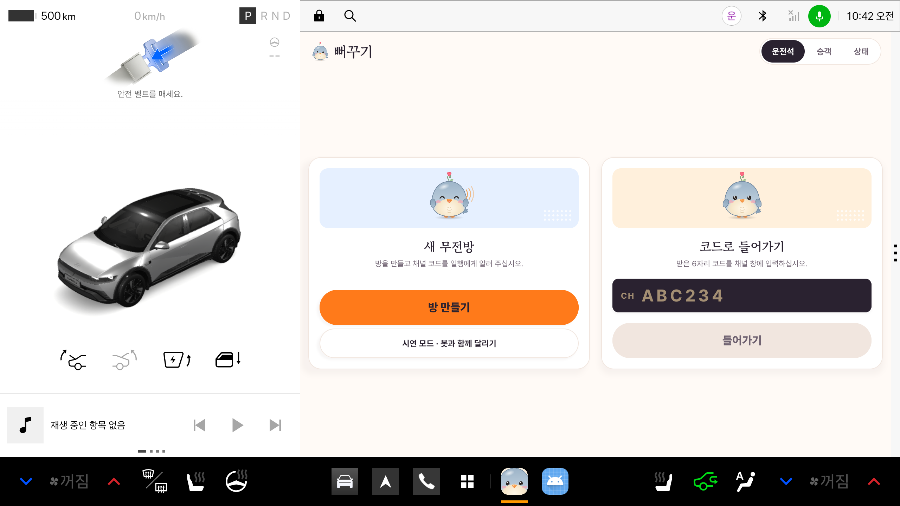
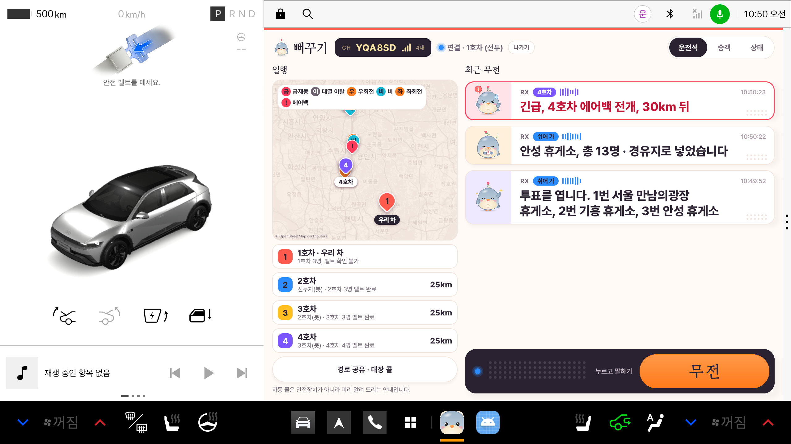
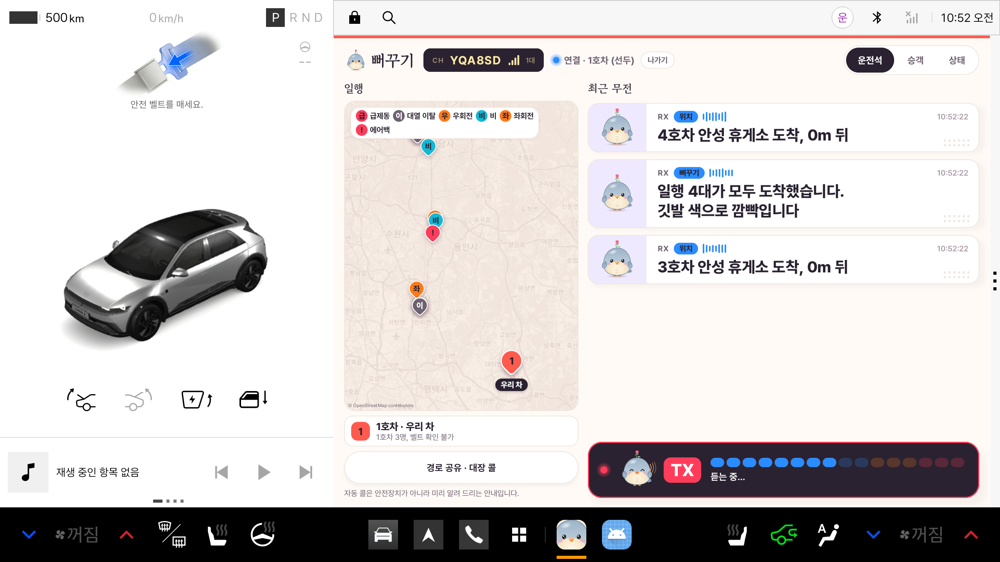
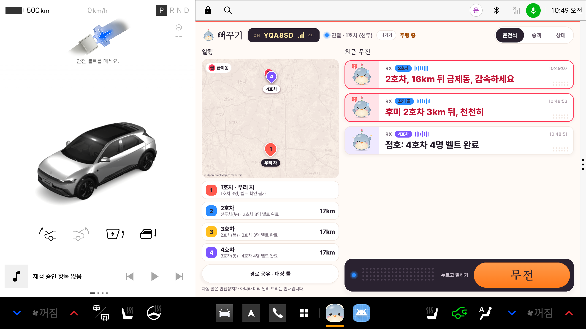
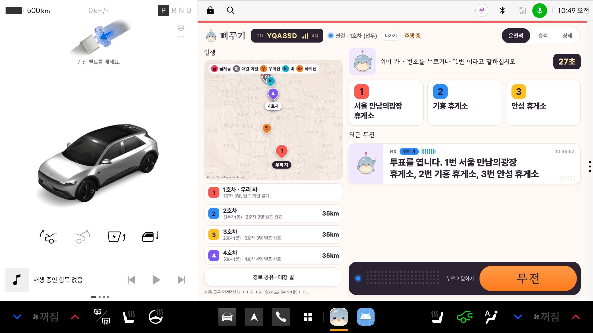
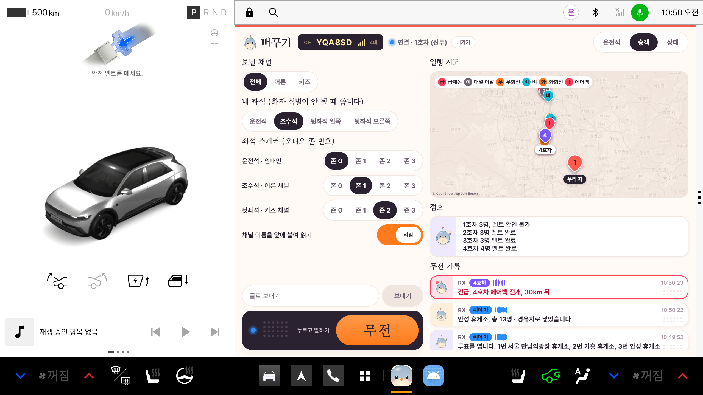
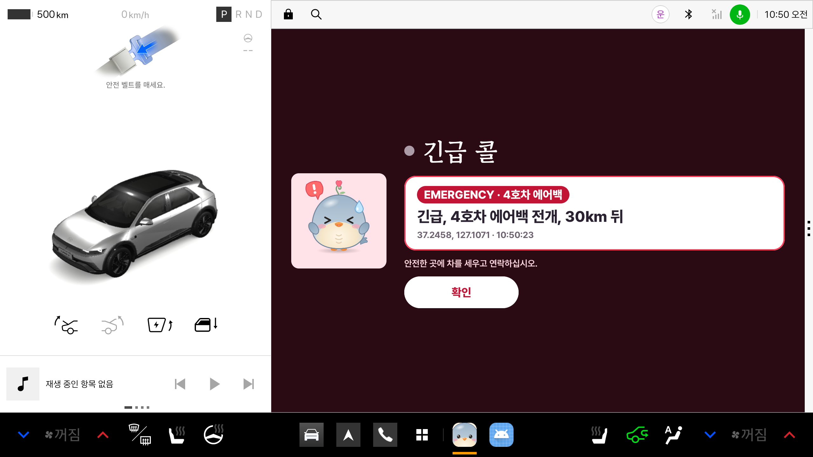
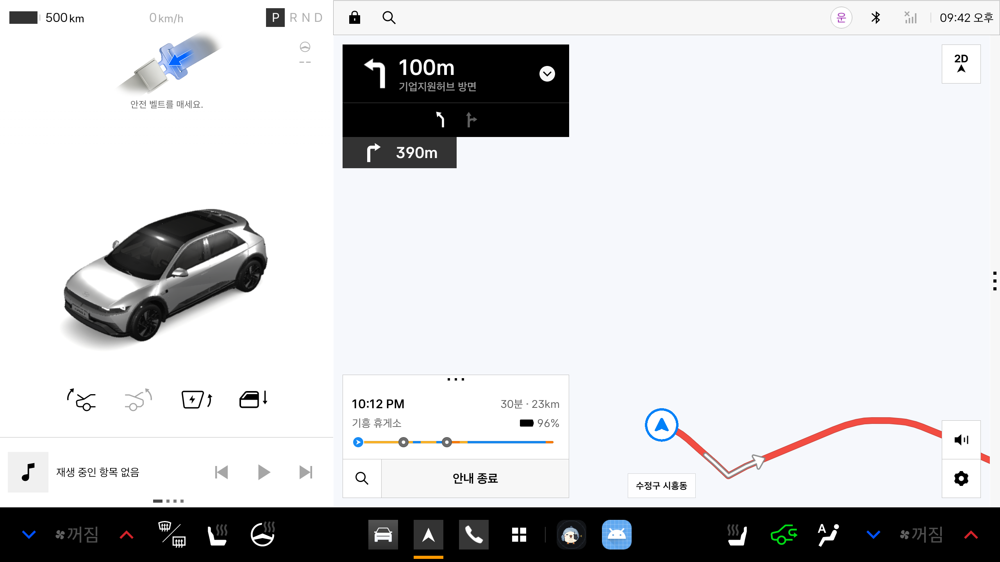
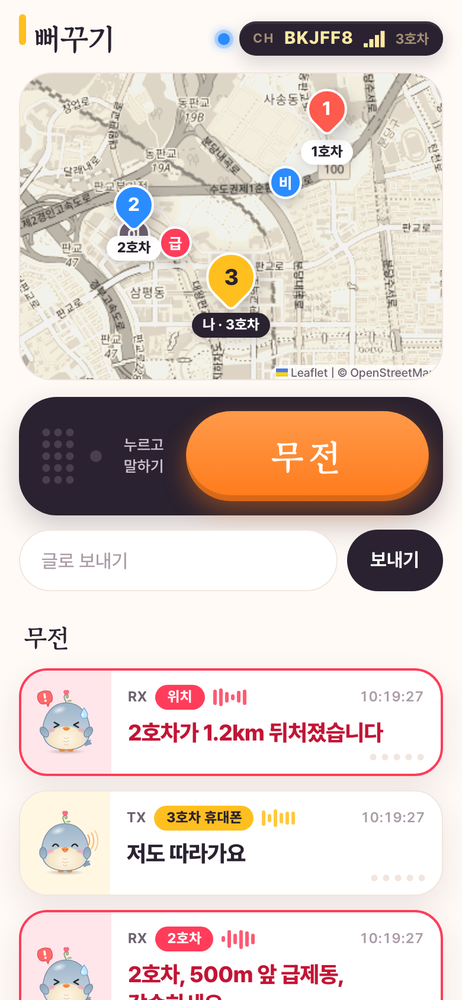
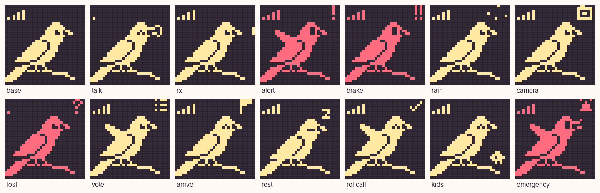

# 뻐꾸기: 차가 먼저 말하는 단체 무전

현대자동차그룹 Pleos 앱 대회 "Code your App into Pleos App Market" 출품작 서비스 소개서

## 1. 한 줄 소개

> 휴대폰 무전은 사람이 말하고 뻐꾸기는 차가 말합니다.

뻐꾸기는 여러 대가 함께 움직일 때 쓰는 Pleos 차량용 단체 무전 앱입니다. 앞차에서 와이퍼가 켜지면 뒤차에 "선두, 비 시작"이 들리고 휴게소 투표 결과는 일행 모든 차의 내비에 경유지로 들어갑니다. 뻐꾸기시계가 때맞춰 "뻐꾹" 하고 알리듯 차가 필요한 순간에 일행에게 소식을 전한다는 뜻으로 이름을 지었습니다. 영문 이름은 Cuckoo입니다.

## 2. 여러 대가 함께 갈 때 생기는 불편

명절 귀성길, 캠핑 동호회, 가족 여행처럼 차 여러 대가 같은 곳으로 갈 때는 소식이 늘 늦게 전해집니다.

- 앞차가 비를 만나거나 급하게 멈춰도 뒤차는 직접 보기 전까지 알지 못합니다.
- 휴게소를 정하려면 운전 중에 전화를 돌려야 하고 한 대가 지나쳐 버리면 다시 모이기 어렵습니다.
- 출발할 때 누가 어느 차에 탔는지, 안전벨트는 맸는지 확인하려면 차마다 물어봐야 합니다.
- 뒷좌석 아이들은 다른 차에 탄 사촌과 이야기하고 싶어도 방법이 없습니다.

휴대폰 그룹 주행 앱은 지도와 무전을 주지만 사람이 버튼을 눌러야 소식이 전해집니다. 운전자가 말할 여유가 없는 순간일수록 정작 중요한 소식이 빠집니다.

## 3. 해결 방식

뻐꾸기는 차량 신호를 읽어 일행에게 먼저 알리고 좌석과 내비를 일행 단위로 묶습니다.

| 차가 아는 것 | 뻐꾸기가 일행에게 하는 일 |
|---|---|
| 위치 | 모든 차의 위치를 일행 지도에 띄우고 "2호차, 3.3km 뒤"처럼 서로의 거리와 처짐·도착을 알립니다 |
| 브레이크와 속도 변화 | 급제동을 감지해 다른 차에 "2호차, 1.2km 앞 급제동, 감속하세요"를 알리고 지도에 표시합니다 |
| 와이퍼 | 와이퍼가 켜진 지점을 보내 뒤차에 "5km 앞부터 비"를 전합니다 |
| 방향지시등과 내비 안내 | 선두가 500m 안에서 회전할 때만 "선두, 300m 앞 우회전"을 알립니다 |
| 좌석 착석과 안전벨트 | 출발할 때 모든 차의 탑승 인원과 벨트 상태를 모아 점호합니다 |
| 좌석별 스피커 | 뒷좌석끼리 차를 넘어 키즈 채널로 이야기하게 합니다 |
| 순정 내비 | 투표로 정한 휴게소를 모든 차에 경유지로 넣고 선두 경로를 일행이 함께 따라갑니다 |
| 에어백 | 일행 중 한 대라도 에어백이 펴지면 위치와 함께 모든 차에 알립니다 |
| 앰비언트 조명 | 차마다 깃발 색을 정하고 주차장에 모두 모이면 조명을 깜빡여 도착을 알립니다 |

## 4. 기능 구성

무전에서 쓰는 말투로 기능 이름을 붙였습니다. 모든 기능을 Pleos Connect Emulator 2.1.0에서 실행해 확인했습니다.

| 기능 | 하는 일 | 쓰는 Pleos 기능 |
|---|---|---|
| 자동 콜 | 급제동, 비, 회전, 제한속도 변경, 주의 구간을 차가 스스로 알림 | Brake, Wiper, TurnSignal, NaviHelper |
| 일행 지도 | 모든 차의 위치를 깃발 색으로, 급제동·비·에어백 같은 이슈를 핀으로 표시하고 대열 전체가 보이게 자동으로 맞춤 | FusedLocation |
| 위치 알림 | 앞차와의 거리, 대열 처짐과 다시 붙음, 휴게소 도착, 긴 정차를 알리고 5분마다 일행 위치를 요약 | FusedLocation, Gear |
| 받아 적기 | 말을 글로 받아 적어 보내고 받는 차가 음성으로 읽음 | SpeechToText, TextToSpeech |
| 좌석 채널 | 전체·어른·키즈 채널을 나누어 해당 좌석 스피커로 출력 | TextToSpeech 오디오 존, Seat |
| 쉬어 가 | 휴게소 후보 투표, 결과를 모든 차에 경유지로 등록 | NaviHelper `addWaypoint` |
| 다시 붙기 | 대열에서 떨어진 차에 선두를 따라가는 경로를 넣음 | FusedLocation, NaviHelper |
| 점호 | 출발할 때 차마다 탑승 인원과 안전벨트 상태를 모음 | Seat 착석, Gear, Safety |
| 대장 콜 | 선두가 공유한 경로를 모든 차가 함께 다시 탐색 | `requestRouteWithWaypoints` |
| 꼬리 콜 | 후미가 처지면 실제 거리와 함께 선두에 감속을 안내 | FusedLocation |
| 긴급 콜 | 에어백 전개 시 위치와 함께 모든 차에 전체 화면 알림 | Safety 에어백 |
| 깃발 색 | 차마다 고유 색을 앰비언트 조명과 화면 띠에 표시하고 도착하면 깜빡임 | Light 앰비언트 |
| 휴대폰 참여 | Pleos 차가 아닌 일행도 휴대폰 웹으로 위치 공유와 무전에 참여 | 휴대폰 GPS, 웹 음성 인식 |

## 5. 화면

운전자 화면은 일행 지도와 큰 무전 버튼, 최근 무전 3개를 보여 줍니다. 지도는 손으로 조작할 필요 없이 대열 전체가 보이게 스스로 맞춰집니다. 주행 중에는 Android Automotive의 `CarUxRestrictions`를 따라 글자 입력과 작은 버튼을 숨깁니다. 승객 화면에서는 지도를 보면서 채널을 고르고 투표하며 전체 무전 기록을 봅니다. 새 무전이 오면 캐릭터가 상황에 맞는 동작을 합니다.



















## 6. 선행 사례와 차별점

출품 전에 휴대폰 그룹 주행 앱, 바이크 메시 인터콤, 완성차 V2X, 특허, 학술 연구를 조사했습니다.

| 기능 | 가장 가까운 선행 사례 | 뻐꾸기의 위치 |
|---|---|---|
| 차량 신호 알림 | VW Car2X, Volvo Slippery Road Alert, 한국 C-ITS는 반경 안의 모든 차에 위험을 알림. Roger That은 휴대폰으로 정지만 감지 | 받는 대상을 일행으로 한정하고 와이퍼·방향지시등 같은 생활 신호까지 순정 차량 데이터로 중계 |
| 차량 간 좌석 채널 | 한 차량 안 좌석 인터콤 특허(US11039250, EP3434002) | A차 뒷좌석과 B차 뒷좌석을 잇는 사례는 확인되지 않음 |
| 다차량 점호 | 한 차량 안 착석·벨트 인원 계산 특허 | 여러 차의 좌석 상태를 모아 일행 전원을 확인하는 사례는 확인되지 않음 |
| 휴게소 투표 | Ford US9125020, Convoy.im | 기본 기능으로 두고 결과를 각 차 순정 내비에 자동 반영하는 연결에 집중 |
| 합류 경로 | Ford US10818190, Convoy Tracker | 기본 기능으로 두고 순정 내비 경유지로 바로 연결 |

휴대폰 앱은 와이퍼와 좌석 센서를 볼 수 없고 V2X는 누가 일행인지 모릅니다. 뻐꾸기는 두 가지를 모두 아는 Pleos 차량에서만 성립합니다. 차량 간 좌석 채널과 다차량 점호는 이번 조사 범위 안에서 선행 사례를 찾지 못했습니다. 국내 특허(KIPRIS)는 아직 확인하지 않았습니다.

## 7. 안전과 개인정보

- 대상은 가족과 친척, 동호회의 저속 안전 대열입니다. 단체 주행 앱의 카메라 공유는 단속 회피 도구로 읽힐 수 있어 단속 카메라 위치는 일행에게 공유하지 않습니다.
- 급제동 알림은 서버를 거치므로 1초 안팎의 지연이 생길 수 있습니다. 화면과 음성에서 안전장치가 아니라 미리 알려 주는 안내라고 밝힙니다.
- 위치는 방에 들어와 있는 동안에만 공유합니다. 방은 마지막 활동 후 24시간이 지나면 기록과 함께 삭제됩니다.
- 음성 원본은 차 밖으로 내보내지 않고 받아 적은 글만 보냅니다.
- 휴대폰 참여자에게는 위치 공유 동의를 먼저 받습니다.

## 8. 시스템 구조

```
[Pleos 차량 앱] ─┐
[Pleos 차량 앱] ─┼─ WebSocket ─ [Cloudflare Worker + Durable Object: 방 1개 = 일행 1팀]
[휴대폰 웹]   ─┘
```

- 차량 앱: Kotlin, Jetpack Compose, Android Automotive. Pleos SDK `Vehicle 2.3.2`, `NaviHelper 3.0.5`, `FusedLocation 1.1.3`, `TextToSpeech 3.3.1`, `SpeechToText 3.3.1`을 씁니다.
- 서버: 방 코드 하나가 Durable Object `Room` 하나에 대응합니다. WebSocket Hibernation API를 써서 무전이 없는 동안의 비용을 줄입니다. 메시지는 8KB로 제한합니다.
- 서버가 판정하는 것: 차 사이의 거리와 앞뒤 순서, 대열 처짐과 다시 붙음, 휴게소 도착과 긴 정차, 휴게소 투표 집계, 일행 전원 도착(150m 안에서 모두 P단). 같은 알림은 2분에 한 번만 보냅니다.
- 시연용 가상 차량: 에뮬레이터는 한 대뿐이므로 `bots.mjs`가 경부고속도로 서울 요금소부터 안성 휴게소까지 달리는 일행 차를 대신합니다.

## 9. 시연 시나리오: 명절 귀성길 친척 4대

1. 시연 모드로 방을 만들면 가상 차량 3대가 들어오고 선두가 경로를 공유합니다.
2. 출발 점호에서 차마다 탑승 인원이 모이고 휴게소 안내에 일행 전체 인원이 붙습니다.
3. 일행 지도에 모든 차가 깃발 색으로 나타나고 차가 처지거나 다시 붙으면 거리와 함께 알림이 나옵니다.
4. 앞차가 급제동하거나 와이퍼를 켜면 에뮬레이터 차량에서 거리를 붙인 음성 안내가 나오고 지도에 핀이 찍힙니다.
5. 일행 중 한 명이 "화장실 가고 싶다"고 말하면 쉬어 가 투표가 열립니다. 투표 결과 안성 휴게소가 내비에 경유지로 들어갑니다.
6. 4호차 에어백 전개 신호를 주입하면 모든 차에 빨간 전체 화면 알림이 뜹니다.
7. 휴게소 주차장에 모두 모이면 "일행 4대가 모두 도착했습니다" 안내와 함께 깃발 색이 깜빡입니다.

## 10. 구현과 검증 현황

- 차량 앱 단위 테스트 13건과 서버 테스트 40건이 모두 통과합니다.
- 릴리스 APK를 에뮬레이터에 설치해 9장의 시나리오를 처음부터 끝까지 실행했습니다.
- 차량 신호는 Pleos Virtual Console로 주입해 확인했습니다.

| 항목 | 에뮬레이터 결과 | 실차에서 확인할 것 |
|---|---|---|
| 브레이크, 와이퍼, 방향지시등, 기어, 착석 | 수신 확인 | 해당 없음 |
| 경유지 추가, 경로 재탐색 | 내비에 "경유지 1개 포함" 경로 표시 확인 | 해당 없음 |
| 좌석별 TTS | 오디오 존 0~3 호출 성공 | 좌석별로 실제 소리가 나뉘는지 |
| 앰비언트 조명 | 설정 성공 응답 확인 | 실제 색과 깜빡임 |
| 안전벨트, 에어백 | 에뮬레이터가 해당 신호를 지원하지 않음 | 실제 신호 수신. 시연에서는 디버그 버튼으로 주입 |
| 휴대폰 참여 | 데스크톱 브라우저에서 확인 | 실제 휴대폰의 위치와 마이크(HTTPS 배포 필요) |

## 11. 캐릭터와 화면 디자인

화면은 휴대용 무전기를 본떴습니다. 따뜻한 종이색 바탕에 둥근 카드를 붙이고, 위쪽의 어두운 LCD 띠에 채널 코드와 신호 세기, 일행 수를 띄웁니다. 받은 무전은 "RX" 표시와 보낸 차 이름표, 파형으로 보여 줍니다. 무전 버튼은 큰 주황색 알약 모양이며 누르는 동안 빨간 송신 표시등과 음량 막대가 켜집니다. 제목과 무전 버튼 글자는 고운바탕, 본문은 Pretendard입니다. 운전석 본문은 24sp 이상으로 키워 운전 중에도 한눈에 읽히게 했습니다.

마스코트는 동그란 몸에 새싹 안테나를 단 아기 뻐꾸기입니다. 기본, 무전, 경고, 휴게, 점호, 키즈 채널의 여섯 가지 표정이 상황마다 바뀌고 앱 아이콘도 같은 캐릭터의 얼굴로 만들었습니다. 승객 화면과 입장 화면에서는 천천히 들썩이지만 주행 중 운전자 화면에서는 새 무전이 왔을 때 한 번만 튀어나오고 멈춰 운전자의 시선을 오래 끌지 않습니다. 긴급 콜 화면에서는 주행 중에도 계속 경고 동작을 합니다.



## 12. 앞으로의 계획

- 실차에서 좌석별 오디오 존, 앰비언트 조명, 안전벨트·에어백 신호를 확인합니다.
- 서버를 배포해 휴대폰 참여를 실제 휴대폰에서 시험합니다.
- 다시 접속해도 차 번호와 선두 역할이 유지되게 하고 앞뒤 순서를 직선 거리 대신 경로를 따라간 거리로 판정합니다.
- 대열 경로와 무전 기록을 여행 앨범으로 정리하는 무전 일지를 추가합니다.
